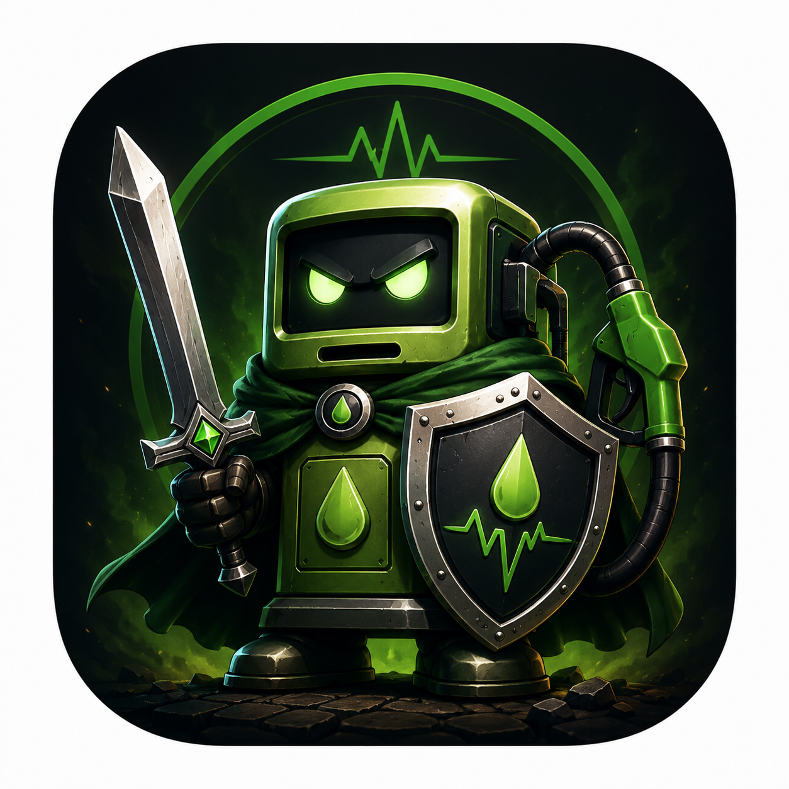
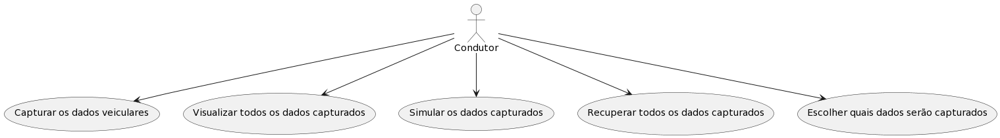

# Fuel Sentinel (Aplicativo OBD)

<p align="center">
  
</p>

<p align="center">
  <b>Diagnóstico veicular e coleta de dados OBD-II pelo celular</b>
</p>

<p align="center">
  
  
  
  
</p>

> **Este repositório guarda a versão 1.0 e não recebe mais mudanças.**
> O desenvolvimento a partir da versão 1.1 continua em
> [Fuel-Sentinel-V2](https://github.com/gabestk/Fuel-Sentinel-V2), que tem APK para baixar,
> coleta em CSV no formato do OBDLink e conferência de abastecimento em três etapas.

Um aplicativo mobile em Flutter para diagnóstico veicular e coleta de dados de sensores.

O Fuel Sentinel se conecta a adaptadores OBD-II (a porta de diagnóstico do carro) via Bluetooth, registra o status do veículo e dados de GPS, armazena registros locais utilizando Hive e integra com o Firebase Cloud Firestore para sincronização com o backend.

## Índice

- [O que o projeto faz](#o-que-o-projeto-faz)
- [Versões](#versões)
- [Diagramas](#diagramas)
- [Por que este projeto é útil](#por-que-este-projeto-é-útil)
- [Principais funcionalidades](#principais-funcionalidades)
- [Primeiros passos](#primeiros-passos)
  - [Pré-requisitos](#pré-requisitos)
  - [Clonar e instalar](#clonar-e-instalar)
  - [Configurar o Firebase](#configurar-o-firebase)
  - [Executar o aplicativo](#executar-o-aplicativo)
  - [Tarefas de desenvolvimento](#tarefas-de-desenvolvimento)
- [Estrutura do projeto](#estrutura-do-projeto)
- [Suporte](#suporte)
- [Contribuição](#contribuição)
- [Observações](#observações)

---

## O que o projeto faz

O Fuel Sentinel é uma aplicação Flutter desenvolvida para coletar e visualizar dados telemáticos de veículos utilizando informações OBD-II e sensores do dispositivo. Ele gerencia conexões Bluetooth com dispositivos OBD, obtém respostas de PIDs, registra dados de GPS e acelerômetro, e pode sincronizar os dados coletados com o Firebase.

---

## Versões

| Versão | Onde está | Situação |
|---|---|---|
| **1.0.0** | este repositório (branches `main`, `test` e `versao-1.0`) | versão original, com escolha livre de PIDs e envio dos dados para a nuvem |
| **1.1 em diante** | [`gabestk/Fuel-Sentinel-V2`](https://github.com/gabestk/Fuel-Sentinel-V2) | em desenvolvimento |

---

## Diagramas

**Casos de uso do condutor**

<p align="center">
  
</p>

**Fluxo de interação**

<p align="center">
  
</p>

---

## Por que este projeto é útil

Este aplicativo é útil para desenvolvedores, pesquisadores e engenheiros que desejam uma base funcional para soluções de diagnóstico veicular e monitoramento de frotas. O projeto demonstra:

- conectividade Bluetooth OBD-II em tempo real
- persistência local de dados utilizando Hive
- inicialização do Firebase e integração com Cloud Firestore
- gerenciamento de permissões Android para Bluetooth, localização e armazenamento
- execução de tarefas em segundo plano com Workmanager
- descoberta dinâmica de PIDs e monitoramento OBD configurável

---

## Principais funcionalidades

- Descoberta e conexão com adaptadores Bluetooth OBD-II
- Gerenciamento de PIDs OBD, incluindo consultas de nível de combustível e VIN
- Armazenamento local de dados utilizando Hive
- Suporte a backend Firebase via `firebase_core` e `cloud_firestore`
- Sensoriamento de GPS e movimento utilizando `geolocator` e `sensors_plus`
- Execução de tarefas em segundo plano via `workmanager`
- Sistema modular de rotas com `auto_route`
- Suporte para dados OBD simulados e intervalos de amostragem configuráveis

---

## Primeiros passos

### Pré-requisitos

- Flutter SDK compatível com Dart `^3.5.3`
- Android Studio ou Xcode para deploy mobile
- Dispositivo Android ou emulador com suporte a Bluetooth (Android é o alvo principal)
- Um projeto Firebase configurado caso deseje sincronização com Firestore

---

### Clonar e instalar

```bash
git clone https://github.com/gabestk/fuel_sentinel.git
cd fuel_sentinel
flutter pub get
```

---

### Configurar o Firebase

As opções do Firebase são carregadas a partir de `lib/functions/firebaseOptions.dart`.

Atualize este arquivo com as configurações do seu projeto Firebase ou substitua-o pela sua própria configuração.

Caso o projeto ainda não esteja configurado, utilize o Firebase CLI ou o console do Firebase para criar uma nova aplicação e baixar os dados de configuração gerados.

---

### Executar o aplicativo

```bash
flutter run -d <device-id>
```

Para Android:

```bash
flutter run -d emulator-5554
```

O aplicativo solicita permissões de Bluetooth, localização e armazenamento em tempo de execução ao ser iniciado.

---

### Tarefas de desenvolvimento

Execute a geração de código e limpe artefatos antigos ao atualizar rotas ou modelos gerados:

```bash
flutter pub run build_runner build --delete-conflicting-outputs
```

Caso faça alterações em rotas ou adapters do Hive, execute novamente a geração de código para recriar arquivos como `lib/route/autoroute.gr.dart`.

---

## Estrutura do projeto

- `lib/main.dart` — ponto de entrada da aplicação, inicialização do Firebase, configuração do Hive, gerenciamento de permissões e registro do Workmanager
- `lib/route/autoroute.dart` — declarações de rotas utilizadas pelo `auto_route`
- `lib/screens/` — páginas principais da aplicação, como dashboard OBD e telas de configuração
- `lib/widgets/` — widgets reutilizáveis para Bluetooth, coleta de dados, configuração e mapas
- `lib/dataBaseClass/` — modelos Hive e classes de banco de dados local
- `lib/functions/` — funções auxiliares para integração OBD e opções do Firebase
- `pubspec.yaml` — manifesto de dependências e configurações do Flutter

---

## Suporte

Caso precise de ajuda ou queira reportar um bug:

- abra uma issue no GitHub deste repositório
- revise os arquivos em `lib/` para detalhes de implementação
- consulte o `pubspec.yaml` para versões de pacotes e dependências

---

## Contribuição

Contribuições são bem-vindas através de issues e pull requests. Siga o fluxo padrão do GitHub:

1. Faça um fork do repositório
2. Crie uma branch para sua funcionalidade
3. Teste suas alterações localmente
4. Envie um pull request com uma descrição clara

Caso adicione diretrizes formais de contribuição, inclua um arquivo `CONTRIBUTING.md` no repositório.

---

## Observações

- O nome atual do pacote é `obdapp` e o aplicativo utiliza um fluxo Bluetooth focado em Android.
- Atualmente não há um arquivo `LICENSE` no repositório. Adicione um caso deseje publicar ou compartilhar o projeto publicamente.
- O fluxo principal de execução está configurado em `lib/main.dart`, incluindo `Hive.initFlutter`, inicialização do Firebase e registro de tarefas em segundo plano.
