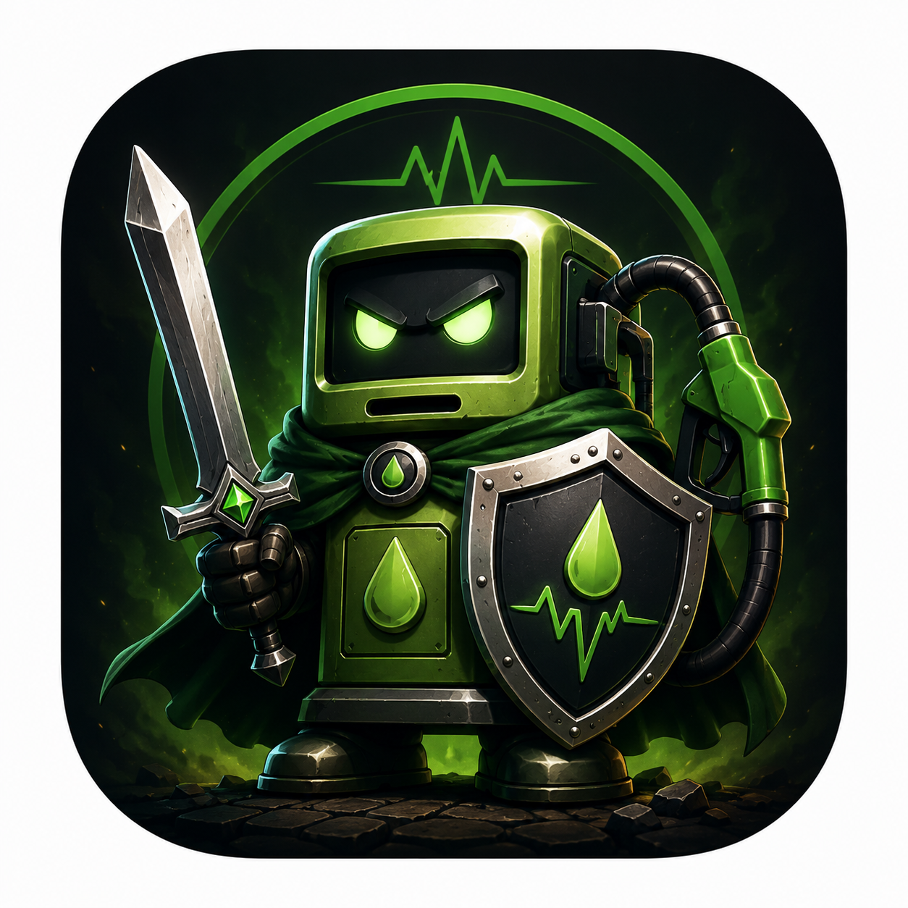

# Fuel Sentinel

<p align="center">
  
</p>

<p align="center">
  <b>Conferência de abastecimento e coleta de dados OBD-II pelo celular</b><br>
  <a href="https://github.com/gabestk/fuel_sentinel/releases/download/teste/fuel-sentinel.apk">📲 Baixar o APK</a> ·
  <a href="#funcionalidades">Funcionalidades</a> ·
  <a href="#para-desenvolvedores">Para desenvolvedores</a>
</p>

<p align="center">
  <a href="https://github.com/gabestk/fuel_sentinel/actions/workflows/testes.yml"></a>
  
  
  
</p>

O Fuel Sentinel se conecta a um adaptador **OBD-II** (a porta de diagnóstico do carro) com chip
**ELM327** pelo Bluetooth e faz duas coisas:

- **Confere um abastecimento**: mede o nível do tanque antes e depois e compara com a quantidade
  informada na bomba.
- **Coleta dados do veículo**: lê os PIDs (os códigos de cada sensor) escolhidos e grava um CSV no
  mesmo formato do aplicativo OBDLink, junto com o GPS e os sensores do celular.

Tudo fica salvo só no celular, e cada coleta pode ser aberta no próprio app, vista no mapa ou
compartilhada.

---

## Sumário

- [Instalar](#instalar)
- [Funcionalidades](#funcionalidades)
  - [Abastecimento](#abastecimento)
  - [Scanner](#scanner)
  - [Coletas salvas](#coletas-salvas)
  - [Configuração](#configuração)
- [Arquivos gerados](#arquivos-gerados)
- [Versões](#versões)
- [Para desenvolvedores](#para-desenvolvedores)
- [Limitações conhecidas](#limitações-conhecidas)

---

## Instalar

1. No celular Android, baixe o APK: **[fuel-sentinel.apk](https://github.com/gabestk/fuel_sentinel/releases/download/teste/fuel-sentinel.apk)**
2. Abra o arquivo e permita a instalação de fontes desconhecidas, se o Android pedir.
3. Pareie o adaptador OBD-II nas configurações de Bluetooth do celular (a senha costuma ser `1234` ou `0000`).
4. Abra o app e aceite as permissões de Bluetooth e localização.

> O link sempre aponta para a versão mais recente da branch `test`. Se o Android disser
> **"App não instalado"** ao atualizar, desinstale a versão antiga primeiro (cada build é assinado
> com uma chave diferente). Antes, compartilhe os CSVs que quiser guardar, porque a desinstalação
> apaga os dados do app.

---

## Funcionalidades

### Abastecimento

Confere se o nível do tanque subiu o esperado para a quantidade abastecida. O app lê só dois dados
do veículo: o **nível de combustível** (PID `01 2F`) e o **VIN** (`09 02`, o número de identificação
do veículo).

**Fluxo em três etapas**

| Etapa | O que fazer | O que o app faz |
|---|---|---|
| **1. Nível antes** | Chegar na bomba, carro ligado e parado, e tocar em *Iniciar coleta* | Mede o nível e trava o valor quando ele estabiliza (cerca de 15 s) |
| **2. Abastecer** | Desligar o carro, abastecer e registrar a quantidade (em litros ou em R$) | Guarda a quantidade informada |
| **3. Nível depois** | Ligar o carro e tocar em *Fim do abastecimento* | Mede até o nível parar de subir (máximo de 3 min) e trava o valor |

**Resultado**

- nível antes, nível depois e nível esperado (`antes + litros ÷ capacidade do tanque × 100`)
- litros estimados pelo OBD comparados com os litros informados
- **consistente** se a diferença ficar dentro de 2 pontos percentuais, ou **alerta** se passar

**Como o app decide que o nível estabilizou**

O sensor de nível é uma boia: o valor oscila com o combustível balançando, e muitos carros filtram
a leitura de propósito, que sobe devagar depois de abastecer. Por isso o valor travado é a
**mediana** (o valor do meio, que ignora picos) das leituras dos últimos 30 s, aceita só quando:

- há pelo menos 6 leituras cobrindo pelo menos 15 s
- a variação entre as leituras é de até 1 ponto percentual
- o valor parou de subir ou descer (no máximo 0,5 ponto entre a primeira e a segunda metade da janela)

Se o carro andar (com o PID de velocidade disponível), a medição recomeça. Também dá para travar na
hora com *Usar valor atual*, e o resultado fica marcado como "sem estabilizar".

### Scanner

Coleta livre de PIDs, no estilo do OBDLink:

1. **Conectar** ao adaptador pareado. O app inicializa o ELM327 e mostra a versão e o protocolo.
2. **Buscar PIDs**: lista todos os PIDs do modo 01 que o veículo informa como suportados.
3. **Selecionar** os PIDs e os **calculados** (consumo instantâneo, Fuel Rate, CO2, potência, torque, distância...).
4. **Iniciar coleta**: uma tela mostra o trajeto no mapa, os itens coletados e a quantidade de linhas.
   O botão **Fim da volta** marca voltas de um percurso (coluna `Lap` do CSV).
5. **Parar coleta**: fecha o CSV e mostra onde ele foi salvo.

A gravação é de 1 linha por segundo (ou 2, 5 ou 10), sempre com o último valor de cada PID. PIDs
lentos (temperaturas, nível) são lidos com menos frequência, para os rápidos (rotação, velocidade,
MAF) atualizarem mais.

<details>
<summary><b>Fórmulas dos PIDs calculados</b></summary>

Ajustadas a um CSV real do OBDLink, com diferença relativa abaixo de 0,002 %:

| Coluna | Fórmula |
|---|---|
| Fuel Rate (l/hr) | MAF × 3600 / (AFR × densidade) = MAF × 0,33279 (AFR 14,7 e 0,7359 kg/L) |
| CO2 flow (g/s) | Fuel Rate × 2347,7 g/L / 3600 |
| Instant Fuel Economy (l/100 km) | Fuel Rate / velocidade × 100 |
| Engine Power (PS) | MAF × 1,188916 |
| Engine Torque (N•m) | Engine Power × 7219,6 / rpm |
| Mass air flow rate (calculated) | rpm/120 × MAP × cilindrada × eficiência volumétrica × M_ar / (R × T) |
| Trip Distance, Trip Fuel | integrais da velocidade e da Fuel Rate |
| Fuel Remaining (l) | nível de combustível × capacidade do tanque |

Assim como o OBDLink, as fórmulas assumem gasolina pura e não usam o teor de etanol nem as
correções de combustível. AFR, densidade, preço, tanque, cilindrada e eficiência volumétrica podem
ser alterados nos ajustes do Scanner.

</details>

### Coletas salvas

Disponível no Abastecimento e no Scanner. Para cada arquivo:

- **Abrir no app**: mapa com o trajeto (início, fim e voltas), gráfico e tabela
- **Abrir em outro aplicativo**
- **Compartilhar**: WhatsApp, e-mail, Drive e outros
- **Apagar**

O mapa usa o OpenStreetMap, sem chave de API, e escurece no modo escuro. Sem internet, o trajeto
continua desenhado sobre um fundo liso.

### Configuração

- ler o OBD-II (desligado, a coleta usa só o GPS) e gravar o GPS
- intervalo entre leituras
- taxa de gravação do CSV, GPS, acelerômetro e giroscópio
- **Leitura rápida**: envia o PID com o sufixo `1` (ex.: `010C1`), para o adaptador responder assim
  que a primeira central eletrônica responder. Desligue se vierem muitos valores vazios (alguns
  clones de ELM327 não aceitam).
- tema claro, escuro ou do sistema

---

## Arquivos gerados

Ficam em `Android/data/com.example.obdapp/files/coletas_obd/`, acessível pelo cabo USB no computador.

| Arquivo | Origem | Conteúdo |
|---|---|---|
| `CSVLog_AAAAMMDD_hhmmss.csv` | Scanner | PIDs, calculados, GPS, sensores e `Lap` |
| `Abastecimento_AAAAMMDD_hhmmss.csv` | Abastecimento | nível, VIN, GPS e coluna `Evento` (nível antes, fim do abastecimento, nível depois, salvo) |
| `AAAA-MM-DD_hh-mm-ss.json` (na pasta `files/`, um nível acima) | Abastecimento | quantidade, níveis antes e depois com horário e se estabilizaram, litros estimados, diferença, foto da bomba (hash) e local |

**Formato do CSV** (igual ao do OBDLink, para os mesmos scripts lerem os dois):

- BOM UTF-8, cabeçalho separado por `, `, linhas por `,` e ponto decimal
- 1ª coluna `Time` no formato `09/30/2026 01:36:32.3944 PM`
- colunas com os nomes e unidades do OBDLink (`Engine RPM (RPM)`, `Fuel Rate (l/hr)`...)
- GPS: `Latitude (deg)`, `Longitude (deg)`, `Altitude (m)`, `GPS Speed (km/h)`, `GPS Accuracy (m)`
- sensores: `Accel X/Y/Z (m/s²)`, `Accel (Grav) X/Y/Z (m/s²)`, `Rotation Rate X/Y/Z (deg/s)`
- `PID refresh rate (Hz)` e `Elapsed time (sec)`

Diferenças em relação ao OBDLink: um PID que ainda não respondeu fica **vazio** (o OBDLink grava 0)
e os acumulados da viagem começam no início de cada coleta.

---

## Versões

| Versão | Onde está | Principais mudanças |
|---|---|---|
| **1.1.0** | branches `main` e `test` | Scanner com CSV no formato OBDLink, PIDs calculados, mapa e voltas · Abastecimento em 3 etapas com nível estabilizado e PIDs fixos · comunicação ELM327 por pergunta e resposta · coletas salvas com visualizador e compartilhamento · modo escuro · nova Configuração · leitura do VIN corrigida · ícone do app · envio para a AWS desativado |
| **1.0.0** | branch [`versao-1.0`](https://github.com/gabestk/fuel_sentinel/tree/versao-1.0) e tag `V1.0.0` | versão original, com escolha livre de PIDs no abastecimento e envio para a nuvem |

---

## Para desenvolvedores

### Requisitos

- Flutter **3.47.9** (a 3.48 exige Gradle 9, que o projeto ainda não usa)
- Android SDK e um celular Android com Bluetooth (o alvo principal)
- adaptador OBD-II ELM327 Bluetooth clássico, ou um emulador de ELM327

### Rodar

```bash
git clone https://github.com/gabestk/fuel_sentinel.git
cd fuel_sentinel
flutter pub get
flutter run
```

Depois de mudar rotas ou modelos do Hive, gere o código de novo:

```bash
dart run build_runner build --delete-conflicting-outputs
```

### Build automático

A cada push, o GitHub Actions ([`testes.yml`](.github/workflows/testes.yml)) roda:

1. `flutter analyze` e `flutter test`
2. APK de teste (`fuel-sentinel-debug-apk`) e APK de uso (`fuel-sentinel-apk`) como artefatos
3. na branch `test`, publica o APK de uso na release [`teste`](https://github.com/gabestk/fuel_sentinel/releases/tag/teste), o link de download fixo

### Estrutura

```
lib/
├── main.dart                 inicialização (Hive, Firebase, permissões)
├── functions/
│   ├── elm327.dart           comunicação com o adaptador: um comando por vez, espera o ">"
│   ├── obd_pids.dart         tabela de PIDs, interpretação das respostas e decodificação do VIN
│   ├── obd_calculados.dart   PIDs calculados
│   ├── nivel_estavel.dart    detecção de nível estável (mediana, dispersão e tendência)
│   ├── csv_logger.dart       gravação do CSV linha a linha
│   ├── csv_leitor.dart       leitura do CSV para o visualizador
│   └── pastas.dart           pasta das coletas
├── widgets/
│   ├── getdata.dart          aba Abastecimento (conexão)
│   ├── dataConnect.dart      coleta do abastecimento e fluxo em 3 etapas
│   ├── pidScanner.dart       aba Scanner
│   ├── csvViewer.dart        visualizador (mapa, gráfico e tabela)
│   ├── coletasSalvas.dart    lista de coletas (abrir, compartilhar, apagar)
│   ├── MapGps.dart           mapa do trajeto (OpenStreetMap)
│   └── conf.dart             Configuração
├── screens/                  páginas e rotas
├── route/                    auto_route
└── dataBaseClass/            modelos do Hive
test/
├── obd_pids_test.dart
└── nivel_estavel_test.dart
```

---

## Limitações conhecidas

- **Só Android**: o Bluetooth clássico (SPP) usado pelos adaptadores ELM327 não existe no iOS.
- **Boia não linear**: o sensor de nível é menos preciso perto do tanque vazio ou cheio. O resultado
  do abastecimento é um indicativo, e a curva pode ser calibrada por veículo.
- **Ignição desligada**: com o motor desligado a central eletrônica não responde, por isso o nível
  antes é medido com o carro ligado.
- **Protocolo automático**: a primeira consulta pode levar alguns segundos enquanto o adaptador
  descobre o protocolo do veículo.
- **Assinatura do APK**: cada build usa uma chave diferente, e atualizar exige desinstalar a versão anterior.
- O pacote ainda se chama `com.example.obdapp`, e o repositório não tem arquivo de licença.
